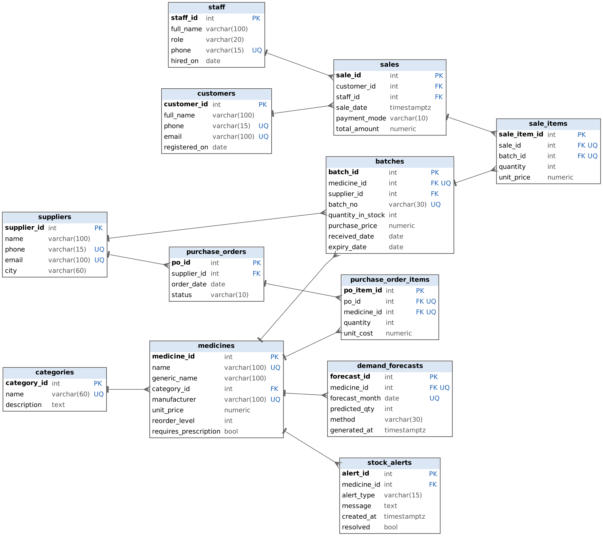

# Pharmacy Inventory, Expiry and Demand Forecasting System

A PostgreSQL-backed system for running a pharmacy's stock: it tracks medicines by batch, blocks the sale of expired or out-of-stock items, raises expiry and low-stock alerts, forecasts next month's demand from sales history, and suggests what to reorder. A Streamlit app sits on top for day-to-day use.



## Features

- **Batch-level inventory.** Every medicine has one or more batches, each with its own expiry date, supplier and remaining stock.
- **Rules enforced in the database.** Triggers reject expired batches and over-selling, reduce stock on every sale, and keep sale totals correct. The app cannot bypass them.
- **Alerts.** Low-stock, near-expiry and expired alerts, created by triggers and scan functions, and resolved automatically when stock is replenished.
- **Demand forecasting.** A 3-month moving average or a 6-month linear trend per medicine, saved to the database and compared with current stock to suggest order quantities.
- **FEFO selling.** The point of sale picks the batch that expires first (First-Expired-First-Out).
- **Purchasing.** Create purchase orders (optionally from forecast suggestions) and receive them into stock as new batches.
- **Streamlit app.** Dashboard, inventory, alerts, point of sale, purchasing, forecast and sales history.

## Tech stack

| Layer | Technology |
|---|---|
| Database | PostgreSQL 14+ (tested on 16) |
| Business logic | PL/pgSQL triggers and functions |
| Forecasting and scripts | Python 3, pandas, scikit-learn, psycopg2 |
| Web app | Streamlit 1.50+ |

## Repository layout

```
.
├── 01_schema.sql              Tables, constraints, indexes, views
├── 02_functions_triggers.sql  Triggers and alert / receiving functions
├── 03_sample_data.sql         Seed data (dates relative to today)
├── 04_queries.sql             16 labelled report queries
├── 05_transactions.sql        COMMIT / ROLLBACK / SAVEPOINT demos
├── 06_constraint_tests.sql    18 PASS/FAIL tests
├── 07_normalization.md        UNF -> 1NF -> 2NF -> 3NF -> BCNF write-up
├── CHANGES.md                 Fixes made after review
├── rebuild.sh                 Rebuilds the database from scratch
├── er_diagram.png / .dot / .mmd   ER diagram (image, Graphviz, Mermaid)
├── requirements.txt           Python dependencies
├── .env.example               Database settings template
├── ai/
│   ├── db.py                  Shared connection helper (reads .env)
│   ├── generate_sales_data.py Loads 12 months of realistic sales history
│   ├── forecast_demand.py     Forecasts next month and saves it
│   └── expiry_alerts.py       Creates and prints alerts
└── app/
    └── app.py                 Streamlit app
```

> If your SQL files live in a different folder, update the paths in `rebuild.sh`.

## Getting started

### 1. Prerequisites

- PostgreSQL 14 or newer, with `psql`, `createdb` and `dropdb` on your PATH
- Python 3.10 or newer

### 2. Install Python dependencies

```bash
python -m venv .venv
source .venv/bin/activate        # Windows: .venv\Scripts\activate
pip install -r requirements.txt
```

### 3. Configure the database connection

```bash
cp .env.example .env
```

Edit `.env` with your PostgreSQL host, port, user and password. **Never commit `.env`** (it is in `.gitignore`).

### 4. Build the database

```bash
chmod +x rebuild.sh
./rebuild.sh              # creates a database called "pharmacy"
```

This drops and recreates the database, then runs `01_schema.sql`, `02_functions_triggers.sql` and `03_sample_data.sql`. Pass another name as the first argument to use a different database (and set `DB_NAME` in `.env` to match).

> `01_schema.sql` starts with `DROP SCHEMA public CASCADE`. Only run it on a database you are happy to wipe.

### 5. Load sales history and run the forecast

```bash
python ai/generate_sales_data.py    # run ONCE per rebuild
python ai/forecast_demand.py        # or: --method linear
python ai/expiry_alerts.py          # optional: prints open alerts
```

`generate_sales_data.py` creates about 6 sales a day for 12 months with seasonal patterns (monsoon fevers, winter respiratory illness, allergy season). It uses a fixed random seed, so the same data is produced each time, and it does not change current stock.

### 6. Start the app

```bash
streamlit run app/app.py
```

## The app

| Page | What you can do |
|---|---|
| **Dashboard** | KPIs, 30-day revenue, top sellers, monthly revenue by category |
| **Inventory** | Stock per medicine, batches with expiry status (expired / 30 days / 90 days / ok) |
| **Alerts** | Run the expiry and low-stock scans, resolve alerts |
| **New sale** | Build a cart, pick the customer, staff member and payment mode, complete the sale with FEFO batch picking and a printed receipt |
| **Purchasing** | View, receive and cancel purchase orders; create an order, optionally from forecast suggestions |
| **Forecast** | See saved forecasts and suggested order quantities, chart history against forecast, run the forecast script |
| **Sales history** | Filter sales by date and open the lines of any sale |

Sales are inserted only through `sales` and `sale_items`. The app never writes `batches.quantity_in_stock` or `sales.total_amount`; the triggers do that.

## Database design

12 tables, all in BCNF (see `07_normalization.md` for the full derivation):

| Group | Tables |
|---|---|
| Reference | `categories`, `suppliers`, `staff`, `customers` |
| Inventory | `medicines`, `batches` |
| Sales | `sales`, `sale_items` |
| Purchasing | `purchase_orders`, `purchase_order_items` |
| AI and alerts | `demand_forecasts`, `stock_alerts` |

A medicine is the product; a batch is one physical lot with its own expiry date and stock. `sale_items` references the batch, not the medicine, so the system always knows exactly which lot was sold.

**Views:** `v_medicine_stock` (sellable and expired stock per medicine), `v_low_stock`, `v_expiry_status`.

**Deliberate redundancy** (each kept correct by a mechanism, explained in `07_normalization.md`): `sale_items.unit_price` (price snapshot), `sales.total_amount` (derived total), `batches.quantity_in_stock` (running balance).

## Business rules enforced by the database

| Rule | Mechanism |
|---|---|
| A sale line is rejected if its batch is expired or the quantity exceeds batch stock | `trg_validate_sale_item` (row-locks the batch so two simultaneous sales cannot both pass) |
| A sale line reduces batch stock and adds to `sales.total_amount` | `trg_apply_sale_item` |
| A low-stock alert is created when sellable stock drops below the reorder level | `trg_low_stock_alert` |
| A low-stock alert is resolved when new stock brings the medicine back to the reorder level | `trg_resolve_alert_on_new_batch`, `trg_resolve_alert_on_restock` |
| Expiry alerts for batches expiring within N days or already expired | `fn_generate_expiry_alerts(days)` |
| Low-stock alerts for stock that was loaded already low | `fn_generate_low_stock_alerts()` |
| Receiving a purchase order creates its batches and marks it received | `fn_receive_purchase_order(po_id, shelf_life_days)` |

Constraints (CHECK, UNIQUE, foreign keys with RESTRICT / CASCADE) cover prices, quantities, dates, phone formats, roles, payment modes and forecast months.

## Forecasting

`ai/forecast_demand.py`:

1. Reads units sold per medicine per complete calendar month.
2. Counts months with no sales as 0, so a quiet month pulls the average down.
3. Predicts next month with either the mean of the last 3 months (`moving_average`, default) or a straight-line trend over the last 6 months (`linear`).
4. Upserts the result into `demand_forecasts`, so re-running replaces the old forecast.
5. Prints a reorder suggestion: predicted demand minus sellable stock.

The sample data includes placeholder forecasts labelled `seed_estimate`; running the script replaces them.

## SQL files for the report

| File | Purpose |
|---|---|
| `04_queries.sql` | 16 queries covering joins, subqueries, `HAVING`, window functions, CTEs, `FILTER`, FEFO and stock cover |
| `05_transactions.sql` | 5 demos: commit, savepoint with partial rollback, full rollback, multi-table write, and a failing re-receive. Run once per rebuild, and **without** `ON_ERROR_STOP` |
| `06_constraint_tests.sql` | 18 tests, each of which must be rejected by the database (plus two positive tests), printed as PASS/FAIL |

```bash
psql -d pharmacy -f 04_queries.sql
psql -d pharmacy -f 05_transactions.sql
psql -d pharmacy -f 06_constraint_tests.sql
```

## Troubleshooting

| Problem | Fix |
|---|---|
| App says it cannot connect to the database | Check the `DB_*` values in `.env` and that PostgreSQL is running |
| `rebuild.sh` cannot find `01_schema.sql` | Make sure the SQL files are in the same folder as `rebuild.sh`, or edit the paths |
| `generate_sales_data.py` says history looks loaded | Rebuild the database first, or pass `--force` to add more anyway |
| Forecast page shows `seed_estimate` | Run `generate_sales_data.py` once, then `forecast_demand.py` |
| Charts are empty | There is no sales history yet; run `generate_sales_data.py` |
| `05_transactions.sql` fails on a second run | It expects a freshly built database; run `rebuild.sh` again |

## Known limitations

- Purchase orders 4 to 10 in the sample data are marked `received` without matching batches (on purpose, so the low-stock demo stays intact).
- Receiving a purchase order gives every new batch the same expiry (today plus a shelf life). Real expiry dates from the supplier's pack should be entered afterwards.
- The prescription check in the point of sale is a confirmation tick in the app; the database does not enforce it.
- There is no login or role-based access control.

## Change history

See `CHANGES.md` for the fixes made after review.
